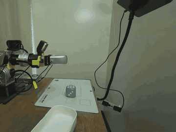
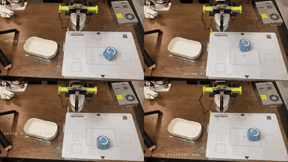
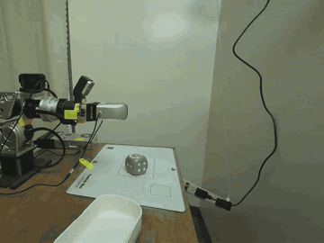
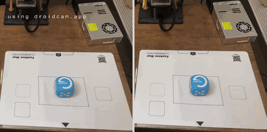

# Imitation learning and VLAs on a real 7-DoF arm

Code, protocols and every logged trial behind a small real-robot benchmark: ACT, Diffusion Policy,
SmolVLA and π0.5 trained on teleoperated demonstrations and run closed-loop on a Seeed Studio
reBot Arm B601-RS under fixed protocols. 110 demonstrations, 176 scored closed-loop trials, success
judged by the operator on the spot.

| | |
| --- | --- |
|  |  |
| SmolVLA, Task 1, start B3 (2×) | SmolVLA, Task 2: red, green, yellow, purple (2×) |
|  |  |
| ACT, Task 2, told “purple”, goes to green (2×) | π0.5 in sync (left) and rtc (right) chunk mode (2×) |

## Reproduce the numbers

Every count, interval and test below is recomputed from the logged trials; no hardware, no
downloads.

```bash
python3 analysis/reproduce_counts.py          # standard library only
python3 analysis/reproduce_chunks.py          # needs numpy
python3 -m unittest discover -s tests -v      # checks each published number (analysis/claims.json)
```

`results/sessions/*.jsonl` are the evaluation runner's own per-trial logs, copied byte for byte from
the rig (one line per run, including smoke tests, invalid runs and their reruns).
`results/adjudication.json` lists which rows are scored and why the others are not; each decision
was made and written down on the day. The analysis applies that file and nothing else.

## Results

95% Wilson intervals. Trials of one condition ran in one session; sessions differ as noted.

**Task 1, pick and place** (15 in-distribution starts: the 9 trained points and 6 midpoints never
used in training; 5 out-of-distribution: three positions 3–5 cm outside the frame, an unseen 20° yaw,
a rubber duck instead of the cube):

| Policy | In distribution | Out of distribution | Notes |
| --- | --- | --- | --- |
| SmolVLA | 13/15 (0.62–0.96) | 1/5 | all 6 failures grasp misses |
| Diffusion Policy | 12/15 (0.55–0.93) | 2/5 | separate day; retrained with the idle start trimmed |
| ACT | 9/15 (0.36–0.80) | 1/5 | temporal ensembling; 4 trials never moved |

**Task 2, “Put the blue cube on the {colour} square.”** (20 trials, each colour × start once; the
five starts are shared by all colours, so only the instruction says where to go):

| Policy | Success | Red | Green | Yellow | Purple | Failures |
| --- | --- | --- | --- | --- | --- | --- |
| π0.5 (sync) | 20/20 (0.84–1.00) | 5/5 | 5/5 | 5/5 | 5/5 | — |
| π0.5 (rtc) | 18/20 (0.70–0.97) | 5/5 | 4/5 | 5/5 | 4/5 | 2 grasp misses, both at A2 |
| SmolVLA | 12/20 (0.39–0.78) | 1/5 | 3/5 | 3/5 | 5/5 | never the wrong square |
| ACT | 4/20 (0.08–0.42) | 0/5 | 4/5 | 0/5 | 0/5 | wrong square 11 (6 on green) |

SmolVLA vs ACT: Fisher two-sided p = 0.022 (same evening). π0.5 vs SmolVLA: p = 0.0033, but π0.5
ran in its own session later; sync vs rtc: p = 0.49.

**Task 2 generalisation, π0.5 sync** (36 scored trials in 4 blocks of 9, random order within a block):

| Dimension | Success |
| --- | --- |
| Same-session control (training starts and sentence) | 9/12 (0.47–0.91) |
| Unseen start (4 cm from the nearest training start) | 5/8 |
| Reworded instruction (two new phrasings) | 7/8 |
| Distractors (two coloured rubber ducks) | 8/8 |
| **Scored total** | **29/36 (0.65–0.90)** |
| Exploratory, not scored: Chinese instruction / blue duck instead of the cube | 0/2, 0/4 |

The control fell below the fixed-layout 20/20 (p = 0.044) and every scored trial started with J4
outside the training range, so the challenge rows compare with the same-session control only.

**Chunk handover, π0.5** (`reproduce_chunks.py`): the commanded fingertip height jumps where a new
50-action chunk takes over. Median handover jump 0.57 cm in sync mode and 0.13 cm with the
background real-time-chunking mode (`--chunk-mode rtc`); 3/20 against 1/18 successful trials had the
target drop ≥ 0.5 cm within 2.5 s of release; median release 23.9 s against 18.9 s.

**Totals**: 60 + 40 + 20 + 20 + 36 = 176 scored trials; 9 more reported separately (3 runs at an
extra Task 1 position, 6 exploratory); 6 invalid runs rerun; 11 smoke tests.

## Setup

- **Arm**: Seeed Studio reBot Arm B601-RS, six arm joints and a gripper on RobStride motors over
  SocketCAN, teleoperated 1:1 in joint space from a Fashion Star Star Arm 102-LD leader. The
  controller runs at 50 Hz and follows the newest target within its speed, joint and tracking limits.
- **Policy inputs**: a RealSense D405 on the wrist and a D435i over the table (RGB 640×480, 30 Hz) and
  the 7 joint angles; the VLAs also get the instruction. A PaXini PX6D-75 wrist force/torque sensor and
  two Daimon DM-Tac W2L visuotactile fingertips were recorded during evaluation but were **not** policy
  inputs.
- **Policies** (LeRobot 0.4.4, [fork commit `90f8f33`](https://github.com/bowenszhu/lerobot/commit/90f8f33d205f7dba7c6c5f473d8d48dd2c9ad315)), presets in `training/train_policy.sh`:
  ACT 60k steps, chunk 60, on the 8 GB laptop GPU; Diffusion Policy 60k steps, horizon 32, DDIM 10;
  SmolVLA fine-tuned from `lerobot/smolvla_base` 20k steps; π0.5 fully fine-tuned from
  `lerobot/pi05_base` 20k steps (bf16, batch 32, one H100). Every policy was trained on one task's
  data only, one seed each. All inference ran on the laptop next to the arm, π0.5 included (bf16, about
  6.5 GiB beside the tactile sensors' CUDA processing). Checkpoints are not published.
- **Datasets**: LeRobot v3, 30 Hz, `observation.state` = measured joints, `action` = target the
  controller actually sent, both in rad relative to the rig's joint reference; frames aligned causally
  (newest frame that arrived before each tick; an episode with > 2% stale ticks or a gap > 0.25 s is
  rejected). Task 1: 50 episodes, 43,607 frames; Task 2: 60 episodes, 47,352 frames
  ([`dataset/`](dataset/) has the data cards and the upload script).

## Protocols

`protocols/*.json` are the frozen protocol files used on the rig (their sha256 is in every trial's
metadata; one checkpoint path in `t2_generalization_protocol.json` was shortened afterwards, so that file's hash no longer matches): the mat layout, start positions, collection schedule, evaluation trials and outcome
categories. Each trial starts with the arm resting on its support near zero and runs for at most
55 s; it ends earlier when the policy brings the arm back to its start and holds it there. The
operator records one category per trial (`success`, `grasp_miss`, `drop`, `place_miss`,
`wrong_square`, `collision`, `stall`, `safety_stop`, `other`) and a note. Executor faults are rerun,
not counted as policy failures. `t3_protocol.json` (pushing a block out of a tower) is in progress:
trial recordings only, no data collection, training or evaluation yet.

## Code

| Path | What it does |
| --- | --- |
| `rebot_bench/sensor_recorder.py` | Records both cameras (and the wrist force sensor) per episode on the host monotonic clock; optionally shares the newest frames in shared memory (`frame_shm.py`) |
| `rebot_bench/episode.py` | One teleoperated demonstration: marks the episode for the recorder, runs the controller, asks keep/reject |
| `rebot_bench/convert_episodes.py` | Offline causal alignment and rejection rule, writes the LeRobot dataset |
| `rebot_bench/policy_server.py` | GPU process: newest frames + joint state → LeRobot policy → one action per 30 Hz tick; `--chunk-mode sync/rtc/blend`; the π0.5 loader that fits an 8 GB GPU |
| `rebot_bench/policy_link.py` | Unix-socket protocol between the controller and the policy server; non-blocking on the control side, hold after 0.5 s, return after 2 s |
| `rebot_bench/evaluate.py`, `eval_next.py` | One closed-loop trial and the trial scheduler; append to `results.jsonl` |
| `rebot_bench/offline_infer.py`, `chunk_replay.py` | Open-loop checks of a checkpoint and offline replay of chunk handovers |
| `training/` | `lerobot-train` presets and Slurm templates (account, partition and paths come from the command line) |
| `analysis/` | Reproduction of every published number |
| `tools/export_chunk_traces.py` | How `results/chunk_handover/` was exported from the raw traces (needs the rig checkout) |

### Controller interface (not included)

The arm's controller, motor driver, safety parameters and kinematic model stay in the private rig
repository; `rebot_bench/rig.py` says where the scripts look for them. Collection and evaluation call
the controller's `run_mirror(args, policy=None)` with the collection flags in
`episode.mirror_command`; with `policy=PolicyClient(...)` it takes targets from the policy instead of
the leader and keeps every protection of teleoperation: joint limits, per-joint speed limits, a
tracking envelope with a 2 s no-progress stop, feedback-limit checks, sensor-freshness checks every
tick, a height-checked staged return and a fault latch. Each tick it sends the measured joint state
(`policy_link` `obs`) and applies the newest action; an action older than 0.5 s holds the last
target, older than 2 s (or a dead link) ends the trial through the normal return. **These scripts
enable and move a real arm; they are published as a record of how the data were taken, not as a
ready-to-run driver for other hardware.**

## Limitations

- Small samples: 5 to 20 trials per condition, one training seed per policy, one scene.
- Success is the operator's judgement on the spot; there is no automatic success detector, and the
  operator knew which policy and condition was running.
- Sessions are not interleaved across all policies: Diffusion Policy ran on another day after
  retraining on trimmed data; π0.5 ran in its own sessions after ACT and SmolVLA; in the second half of
  Task 2 the ACT/SmolVLA order switched from interleaved to blocked. Lighting, temperature and placement
  habits are not balanced across sessions.
- The Task 2 start pose was not controlled: J4 drifted between trials and was outside the training
  range for all 36 scored generalisation trials.
- Camera timestamps are host arrival times, not exposure times; there is no hardware synchronisation.
- Fingertip heights in the chunk analysis come from nominal kinematics without calibration; only
  differences between consecutive commands are used.

## Licence

Code: Apache-2.0 ([LICENSE](LICENSE)). Protocols, results and media: CC BY 4.0. See [NOTICE](NOTICE).

```bibtex
@misc{zhu2026rebotilvla,
  author = {Bowen Zhu},
  title  = {Imitation learning and {VLA} evaluation on a real 7-{DoF} arm},
  year   = {2026},
  url    = {https://github.com/bowenszhu/rebot-il-vla-benchmark}
}
```
